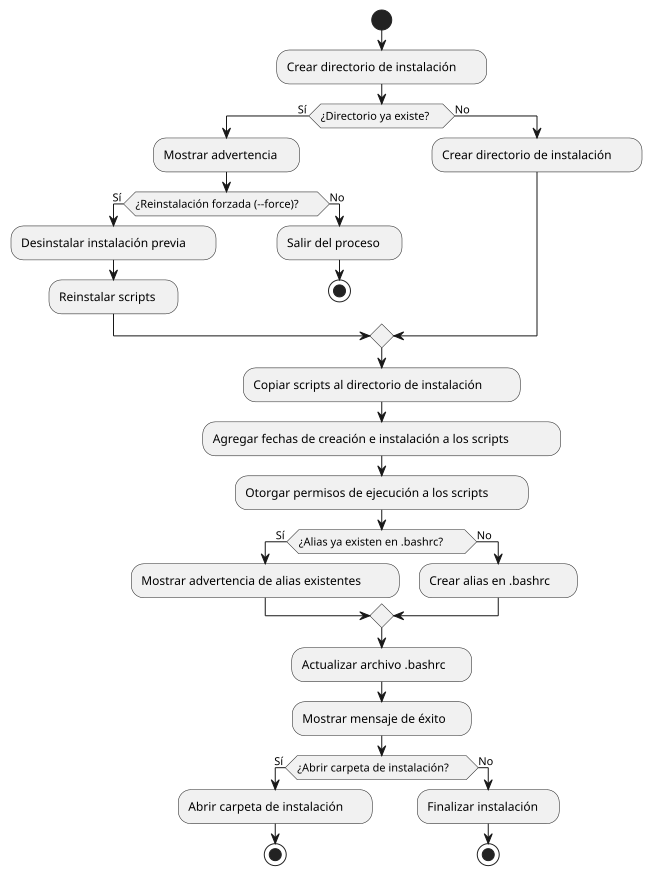

# Manager Repo 

Paquete de instalación para uso global. La versión instalada se ve con `mfs version` (archivo [`VERSION`](Manager_install/VERSION)).

>[!NOTE]
> El panel web (`mfs ui`) es **opcional**: solo se usa si ejecutas `mfs ui` y es lo único que necesita Node.
> Todo lo demás funciona solo con la terminal. Si prefieres la versión anterior, solo terminal y sin panel:
> `git clone -b v8.0.2 https://github.com/noxopio/manager_scripts.git`

Este script ha sido diseñado para optimizar la gestión de múltiples repositorios y microfrontends (Mf), permitiendo la ejecución de tareas comunes como iniciar, clonar o detener microfrontends de manera eficiente, tanto desde la terminal como desde un **panel web local** (`mfs ui`).

---

## Características Principales

- Gestión centralizada de múltiples repositorios mediante un archivo de configuración (`listRep.txt`).
- Clonado, instalación y actualización de dependencias en paralelo.
- Comando de instalación personalizable (`npm ci`, `npm i --legacy-peer-deps`, `pnpm install`…).
- Ejecución y monitoreo de microfrontends.
- Operaciones git en todos los repos: status, commit, push, checkout y nueva rama.
- Soporte para repos privados sin escribir el token en la lista.
- Panel web local con logs independientes por repo, edición y búsqueda de listas, y varios paneles en paralelo.
- Comandos para detener procesos y liberar recursos del sistema.

---

## Requisitos

>[!IMPORTANT]
> **El script debe ejecutarse desde la línea de comandos.**
> 
> Ejemplo:
> ```bash
> ./manager_install.sh      # o: bash manager_install.sh (no "sh": en Ubuntu/Debian es dash)
> ```

1. **Dependencias necesarias**:
   - `npm`
   - `git`
   - `node` (solo para el panel `mfs ui`; no requiere `npm install`)

2. **Permisos de ejecución**:
   Es necesario asegurarse de que los scripts tengan permisos de ejecución:
   ```bash
   chmod +x *.sh
   ```

---

## Instalación de la Herramienta

El script `manager_install.sh` automatiza la instalación de la herramienta `mfs` y configura un alias global para facilitar su uso desde cualquier ubicación.

### Pasos de Instalación

1. Ejecutar el script de instalación:
   ```bash
   ./manager_install.sh
   ```

2. Una vez completada la instalación, el alias `mfs` estará disponible para ejecutar los comandos de la herramienta.

3. Para actualizar una instalación existente:
   ```bash
   ./manager_install.sh --force
   ```

>[!NOTE]
> En caso de que el script no tenga permisos de ejecución, estos pueden otorgarse con el siguiente comando:
> ```bash
> chmod +x manager_install.sh
> ```

---

## Linux y WSL

La instalación es la misma que en Git Bash, con estos detalles:

- **Ejecuta el instalador con bash**: `./manager_install.sh` o `bash manager_install.sh`. No uses `sh manager_install.sh`: en Ubuntu/Debian `sh` es `dash` y los scripts fallan.
- **WSL es otro sistema**: tiene su propio home (`/home/<usuario>`) y su propio `~/.bashrc`. Lo instalado desde Git Bash en Windows no existe dentro de WSL, así que instala mfs también dentro de WSL. Clona en el home de Linux (`~`), no en `/mnt/c/...`.
- **Node para `mfs ui`**: instálalo dentro de Linux/WSL, por ejemplo con nvm:
  ```bash
  curl -o- https://raw.githubusercontent.com/nvm-sh/nvm/v0.40.1/install.sh | bash
  source ~/.bashrc && nvm install --lts
  node --version   # 18 o superior
  which node       # debe ser /home/<usuario>/.nvm/..., no /mnt/c/... (el Node de Windows no sirve)
  ```
- **`cannot execute: required file not found`** (o `$'\r': command not found`): los scripts tienen saltos de línea de Windows (CRLF). El repo fuerza LF con `.gitattributes`, pero si copiaste los archivos desde Windows conviértelos e instala de nuevo:
  ```bash
  sudo apt install -y dos2unix
  dos2unix *.sh ui/* VERSION readme.md && ./manager_install.sh --force
  ```
- **zsh**: el instalador solo escribe en `~/.bashrc`. Añade al final de `~/.zshrc`: `source ~/manager_scripts/manager_rc.sh`
- **Panel en WSL**: `mfs ui --no-open` y abre en el navegador de Windows la URL que muestra (`http://127.0.0.1:4777`).
- **Repos `#NEW`**: se abren en el primer emulador de terminal disponible; sin entorno gráfico corren en segundo plano con la salida en `<repo>/mfs-run.log`.

---

## Archivo de Repositorios (`listRep.txt`)

El archivo `listRep.txt` actúa como el núcleo de configuración de la herramienta `mfs`. Contiene las URLs de los repositorios que serán gestionados.

### Formato del Archivo

- Cada línea debe incluir una URL de repositorio.
- Las líneas que comienzan con `#` se tratan como comentarios y se ignoran.
- Etiquetas disponibles:
  - `#NEW`: Abre el repositorio en una nueva ventana de terminal al ejecutar `run`.
  - `#EXCLUDE`: Excluye el repositorio de las operaciones.
- Es posible agregar el comando a ejecutar con `run` al final de la URL (por defecto `npm run start`).
- Se admiten archivos con saltos de línea de Windows (CRLF) y URLs terminadas en `.git`.

**Ejemplo**:
```text
# Comentario: esta línea se ignora
https://github.com/usuario/repo1.git #NEW
https://github.com/usuario/repo2.git
https://github.com/usuario/repo3.git #EXCLUDE
https://github.com/usuario/repo4.git npm run dev #NEW
https://carlos.camacho@dev.azure.com/org/proyecto/_git/repo5
```

>[!NOTE]
> Es importante asegurarse de que no haya espacios al final de cada URL y que la última línea del archivo contenga un salto de línea.

---

## Comandos Disponibles

| Comando                       | Descripción                                                        |
|-------------------------------|--------------------------------------------------------------------|
| `mfs help`                    | Muestra ejemplos de uso y documentación básica.                    |
| `mfs list`                    | Crea o edita el archivo `listRep.txt`.                             |
| `mfs pull [lista.txt]`        | Clona o actualiza los repositorios especificados.                  |
| `mfs run [lista.txt]`         | Ejecuta los microfrontends configurados.                           |
| `mfs install [lista.txt]`     | Instala las dependencias de los repositorios (omite los que ya tienen `node_modules`). |
| `mfs updeps [lista.txt]`      | Reinstala las dependencias de los repositorios.                    |
| `mfs status [lista.txt]`      | `git status` de cada repo.                                         |
| `mfs -m "msg" commit`         | `git add .` + `git commit` en los repos con cambios.               |
| `mfs push [lista.txt]`        | `git push` de cada repo (nunca `--force`).                         |
| `mfs -b rama checkout`        | Cambia todos los repos a esa rama.                                 |
| `mfs -b rama newbranch`       | Crea la rama en todos los repos y cambia a ella.                   |
| `mfs unlock [lista.txt]`      | Quita bloqueos de git abandonados (`.git/index.lock`), con confirmación. |
| `mfs ui [lista.txt]`          | Abre el panel web local.                                           |
| `mfs ps`                      | Lista los procesos de Node en ejecución.                           |
| `mfs kill`                    | Detiene todos los procesos de Node.js activos.                     |
| `mfs border`                  | Activa o desactiva los bordes de los mensajes.                     |
| `mfs uninstall_manager`       | Desinstala la herramienta y elimina configuraciones.               |

**Opciones** (van antes del comando y se pueden combinar):

| Opción        | Uso                                                                 |
|---------------|---------------------------------------------------------------------|
| `-b <rama>`   | Rama para `pull` y `checkout` (por defecto `main`); nombre nuevo para `newbranch` (obligatorio). |
| `-B <rama>`   | Rama base opcional para `newbranch`; si se omite, usa la rama actual del repo. |
| `-i "<cmd>"`  | Comando de instalación para `install` y `updeps` (por defecto `npm install`). |
| `-m "<msg>"`  | Mensaje para `commit` (obligatorio).                                |

>[!WARNING]
> El comando `mfs list` sobrescribirá el contenido existente del archivo `listRep.txt`. Se recomienda realizar un respaldo si contiene información importante.

>[!NOTE]
> Si algún repositorio falla durante `pull`, `install`, `updeps` o los comandos git, la ejecución termina con código de error 1 y un mensaje indicando que se revise la salida.

---

## Ejemplos de Uso

### Clonar o Actualizar Repositorios (Historial Parcial)
```bash
mfs pull listRep.txt
```

>[!NOTE]
> Para obtener el historial completo ir al respositorio en cuestion y usar :
> ```bash
> git pull --unshallow
> ```

### Usar una Rama Personalizada
```bash
mfs -b fix/branch pull listRep.txt
```
- Si no se especifica una rama, se utilizará `main` como valor predeterminado.
- También cambia de rama en repos ya clonados con historial parcial (`--depth=1`).

### Instalar Dependencias
```bash
mfs install listRep.txt
```

### Usar un Comando de Instalación Personalizado
```bash
mfs -i "npm i --legacy-peer-deps" install listRep.txt
mfs -i "npm ci" updeps
mfs -b develop -i "pnpm install" install
```

### Ejecutar Microfrontends
```bash
mfs run
mfs run ../listas/otra.txt
```

### Actualizar Dependencias
```bash
mfs updeps listRep.txt
```

### Comandos Git
```bash
mfs status                          # git status -sb de cada repo
mfs -m "fix: corrige login" commit  # git add . + commit (omite repos sin cambios)
mfs push                            # git push; si la rama no tiene upstream usa "push -u origin HEAD"
mfs -b develop checkout             # cambia de rama (funciona aunque el clon sea --depth=1)
mfs -b feature/nueva newbranch      # crea desde la rama actual y cambia a ella
mfs -b feature/nueva -B develop newbranch # crea desde develop y cambia a ella
```
- `newbranch` requiere un nombre explícito con `-b`; no crea `main` por defecto.
- Nunca se usa `--force`.
- `git add .` incluye todos los archivos nuevos o modificados (por ejemplo un `package-lock.json` generado por `npm install`). Revisa con `mfs status` antes de hacer commit.

### Error "Another git process seems to be running in this repository"
Git crea `.git/index.lock` mientras trabaja y lo borra al terminar. Si un git se corta a mitad (cerrar la terminal o el panel, Detener o `mfs kill` durante un pull o commit), el archivo queda y git rechaza commit, pull y checkout en ese repo.
```bash
mfs unlock          # lista los repos bloqueados y, tras confirmar, quita los bloqueos
```
- `mfs pull`, `commit`, `push`, `checkout` y `newbranch` avisan y **omiten** los repos bloqueados en lugar de fallar con el error de git.
- En el panel, la tarjeta muestra `🔒 bloqueado` y el botón **Desbloquear**.
- Para evitarlo: no cerrar la terminal o el panel ni usar `mfs kill` en mitad de un pull o commit.

### Repos Privados sin Guardar el Token en la Lista
En `listRep.txt` pon solo el usuario en la URL, y da el token por variable de entorno:
```text
https://carlos.camacho@dev.azure.com/org/proyecto/_git/repo
```
```bash
read -s MFS_GIT_TOKEN; export MFS_GIT_TOKEN   # pide el token sin mostrarlo
mfs pull
```
- Git lo pide a través de `git-askpass.sh` solo cuando el remoto exige credenciales. El token **no se escribe** en la lista ni en `.git/config`.
- También se acepta la forma `https://usuario:@host/...`.
- Las URLs que **ya traen** `usuario:token@` siguen funcionando igual. Se pueden mezclar ambas formas.
- La variable dura mientras la terminal esté abierta.
- Para limpiar un clon antiguo que tiene el token guardado en su `origin`: `git remote set-url origin https://usuario@dev.azure.com/...`.

### Listar Procesos en Ejecución
```bash
mfs ps
```

### Detener Procesos en Ejecución
```bash
mfs kill
```
>[!WARNING]
> `mfs kill` detiene **todos** los procesos de Node del equipo, incluidos los paneles `mfs ui` abiertos.

>[!TIP]
> Utilice el comando `mfs help` para acceder a ejemplos de uso y documentación básica.

---

## Panel Web Local (`mfs ui`)

Interfaz gráfica para gestionar los repos sin memorizar comandos. No cambia el rendimiento: el panel lanza el mismo `manager_repo.sh` en paralelo, un proceso por repo. Solo requiere `node` y escucha únicamente en `127.0.0.1`.

```bash
cd /ruta/donde/estan/los/repos   # el mismo directorio donde está listRep.txt
mfs ui                           # abre http://127.0.0.1:4777 (o el siguiente puerto libre)
mfs ui ../listas/otra.txt        # abrir con otra lista
mfs ui --port 5000 --no-open     # puerto fijo, sin abrir el navegador
```

### Funciones del Panel
- **Tarjeta por repo**:
  - Muestra el estado, la rama, si tiene dependencias, el puerto detectado al ejecutar, y el estado git: `● N cambios`, `↑N` (commits por subir) y `↓N` (commits por traer).
  - Botones por repo: Pull, Install, Run, Detener, Cambios, Commit y Push.
- **Acciones globales** sobre los repos seleccionados: Pull (con rama), Install, Updeps, Run y Detener todo.
- **Log independiente por repo**, en vivo. La casilla **Seguir** desplaza el log hasta la última línea; desmárcala para leer líneas anteriores sin que la vista se mueva.
- **Install con**: comando de instalación personalizado (equivale a `-i`), con sugerencias.
- **Run con**: comando opcional para los repos seleccionados. Vacío conserva el comando de cada repo (o `npm run start` si no está definido). Se recuerda por lista en este navegador y no modifica el `.txt`.
- Indicador discreto de actividad a la derecha del estado del token mientras hay comandos activos; respeta la preferencia del sistema para reducir movimiento.
- Consola vacía con marca de agua MFS, estados vacíos ilustrados e indicadores de estado sutiles en las tarjetas.
- **Git**:
  - Botones: Ver cambios, Commit… (diálogo con el mensaje y la lista de repos con cambios), Push, Checkout y Nueva rama. Nueva rama pide el nombre y permite elegir una base común; por defecto parte de la rama actual de cada repo.
  - Commit omite los repos sin cambios. Push, Checkout y Nueva rama piden confirmación con la lista de repos y su rama.
- **Lista**:
  - El campo acepta cualquier `.txt` (relativo, `C:\...` o `/c/...`) y recuerda las últimas usadas.
  - **📂 Buscar…** abre un explorador para navegar carpetas y unidades, buscar `.txt` por nombre en subcarpetas, usar o editar una lista, o crear una nueva.
- **Editar lista**: editor integrado, importación de repos desde una organización o usuario de GitHub, y plantilla de ejemplo (equivale a `mfs list`).
- **Token git**: token para repos privados, guardado solo en la memoria del panel mientras está abierto (nunca en disco).
- **Procesos Node**: equivale a `mfs ps` / `mfs kill`. Indica cuáles son paneles mfs, y "Matar todos" no los cierra.
- **Ayuda**: muestra el README.
- **Base64**: codifica texto UTF-8, lo decodifica o lo formatea como JSON; la conversión ocurre en el navegador. **Formatear JSON** indenta un JSON pegado directamente (por ejemplo, copiado de la consola), aunque venga escapado como texto o con texto alrededor.
- **cURL**: ejecuta un comando `curl` pegado (bash, cmd, PowerShell o "Copiar como cURL" del navegador) y muestra código, tiempo, cabeceras y la respuesta, con el JSON como árbol plegable. No admite opciones que escriben archivos (`-o`, `-O`, `-D`, `-c`, `--trace`, `-K`). Los últimos 10 comandos se guardan en el navegador, tokens incluidos; se pueden **exportar** a `.txt` (completos u ocultando credenciales) e **importar** desde un `.txt`.
- Todas las confirmaciones usan diálogos propios del panel: Enter acepta y Esc cancela.

### Varios Paneles a la Vez
```bash
cd /proyectos/arl  && mfs ui          # http://127.0.0.1:4777
cd /proyectos/otro && mfs ui          # 4777 ocupado -> usa 4778 automáticamente
```
- Cada panel tiene su carpeta, sus logs y su "Detener todo", que solo afecta a lo que lanzó ese panel.
- Los paneles abiertos se registran en `~/.mfs_ui/panels/`, para que "Matar todos" desde un panel no cierre los demás.

>[!TIP]
> Si Node no encuentra bash (por ejemplo, porque el `bash` del PATH es el de WSL), define la ruta:
> `export MFS_BASH="C:\Program Files\Git\bin\bash.exe"`

---
---

>[!TIP] Notas Adicionales
- Si no se proporciona un archivo al ejecutar un comando, el script buscará uno llamado `listRep.txt` en el directorio actual.
- Si no se encuentra el archivo, se mostrará un mensaje de error y la ejecución se detendrá.
- Para especificar un archivo diferente, proporcione la ruta completa como segundo argumento.

- Asi `mfs run  ../repos/archivo.txt`  

- **Procesar un solo repo de la lista** (lo usa internamente el panel):
  ```bash
  MFS_ONLY=txnportal-app-home mfs pull listRep.txt
  ```
 
- **Activar o desactivar bordes en los mensajes de salida**:
  ```bash
  mfs border
  Mostrar bordes? (true/false): true
  ```
 
- **Eliminar carpetas `node_modules` innecesarias**:
  ```bash
  npx npkill
  ```

- **Remover archivos no rastreados**:
  ```bash
  git clean -fn
  ```

- **Liberar un puerto específico**:
  ```bash
  npx kill-port 4200
  ```
---
---
>[!CAUTION] Desinstalación de la Herramienta

>[!CAUTION]
> Este comando eliminará todas las configuraciones asociadas a la herramienta `mfs`. Se recomienda respaldar cualquier archivo importante antes de proceder.
> ```bash
> mfs uninstall_manager
> ```

>[!NOTE]Clonar e instalar
>Copiar estos comandos. Conserva la carpeta clonada: `mfs update` hace `git pull` en ella.
>```bash
>git clone https://github.com/noxopio/manager_scripts.git
>cd manager_scripts/Manager_install
>chmod +x *.sh
>./manager_install.sh
>```
>Versión solo terminal: `git clone -b v8.0.2 https://github.com/noxopio/manager_scripts.git`. Rama de desarrollo con lo último: `feature/ui`.

----


>[!NOTE]Flujo de instalación 
><div align="center" >
>
>
>
></div>
